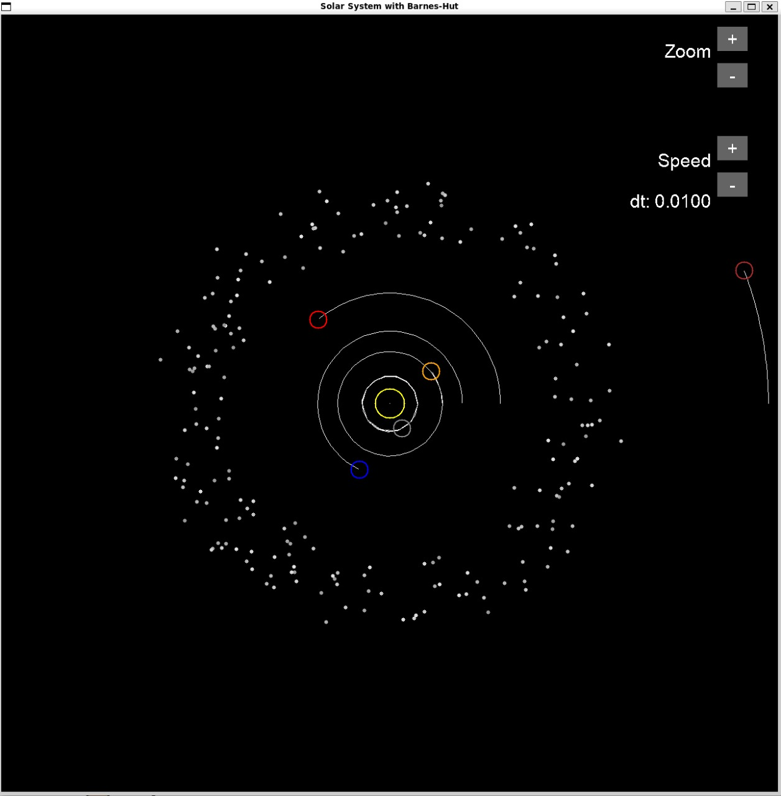
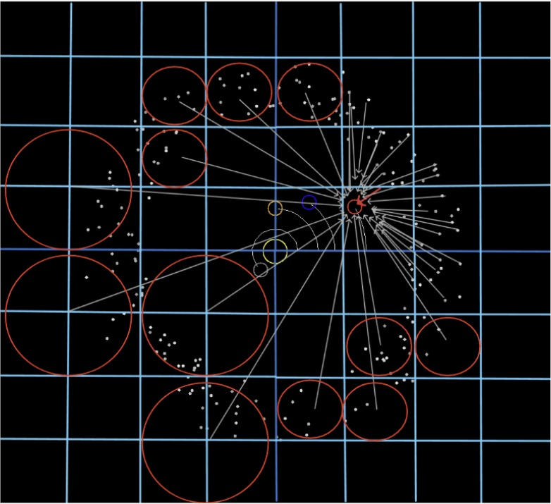

# Solar System Simulation (Barnes-Hut)

A real-time gravity simulation in C with SDL2: the Sun, 8 planets and 200 asteroids pulling on each other.

The point is speed. Instead of computing every pair of bodies, it groups far-away bodies with a quadtree (the Barnes-Hut algorithm).

| Simulation | Barnes-Hut idea |
|:---:|:---:|
|  |  |

## The problem

209 bodies, and every frame each one needs the total gravity from all the others.

**Brute force** checks every pair: 209 × 209 ≈ 43,700 calculations per frame.

**Barnes-Hut** notices that a far-away group pulls almost like one heavy body sitting at its center of mass. So that group needs one calculation, not one per body. That's about 209 × log₂209 ≈ 1,700 calculations per frame, roughly 25 times fewer.

## How it works

Every frame:

1. **Build the quadtree.** Put a square around all bodies. Any square with more than one body is split into 4 smaller squares, again and again, until each square holds at most one body.
2. **Compute centers of mass.** For every square, store its total mass and where its center of mass is.
3. **Compute forces.** For each body, walk the tree from the top. If a square is far away compared to its size (size / distance < 0.5), treat it as one body. If it's close, open it and look inside.
4. **Move.** Update each body's velocity and position from its force (Euler step, F = ma).
5. **Draw** the bodies, the planets' orbit trails and the buttons. Every 100 frames, write a line to `simulation_log.csv`.

## Requirements

- **GCC**, **make**, **SDL2** and **SDL2_ttf** on Linux. On Windows, use WSL with Ubuntu.

## Run

In Ubuntu (or WSL), from the project folder:

```bash
sudo apt install libsdl2-dev libsdl2-ttf-dev
make
./solar_system
```

## Controls

The buttons on the right side of the window:

- **Zoom** `+` / `−`: from 40 to 400 pixels per AU
- **Speed** `+` / `−`: time step from 0.0001 to 0.05

Close the window to quit. The positions and speeds of the planets, and of every 20th asteroid, are saved to `simulation_log.csv`.

## Code

```
main.c       simulation, quadtree, rendering, buttons
planet.h     Planet struct with orbit trail
makefile     build for Linux and macOS
fonts/       fonts for the button labels
```

In `main.c`:

```
create_quadtree(), insert_body()   build the tree
calculate_center_of_mass()         mass and center of each square
calculate_force_from_quadtree()    Barnes-Hut force, THETA = 0.5
update_body()                      Euler step
render_bodies(), DrawButton()      drawing
```
